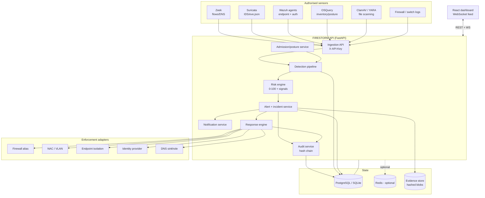
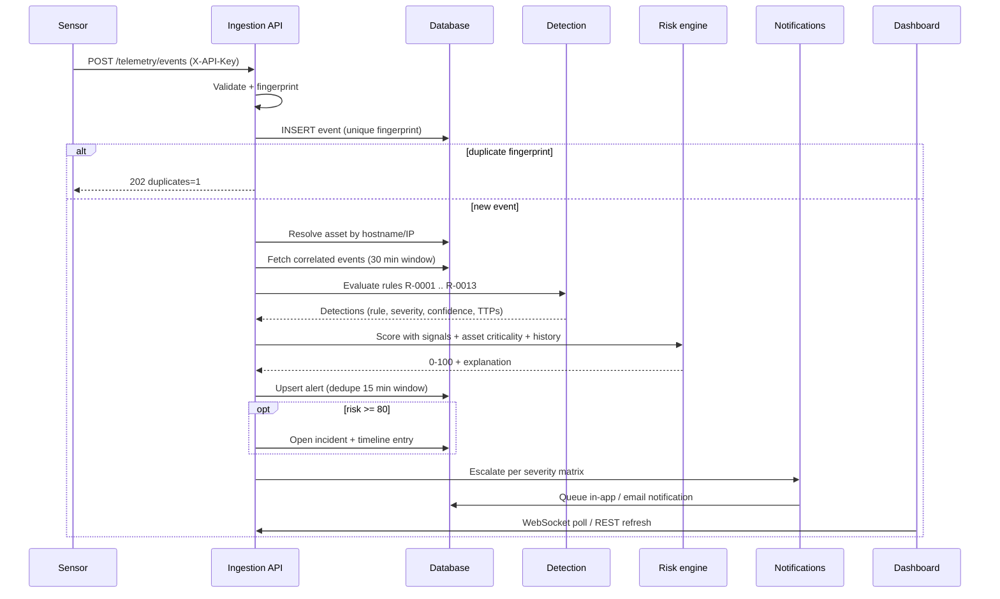
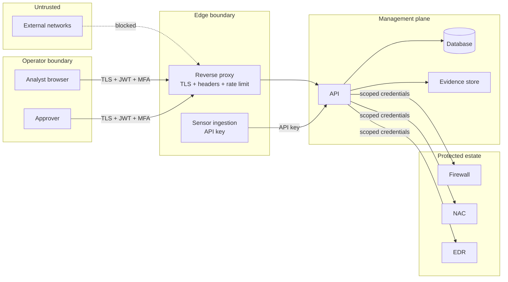
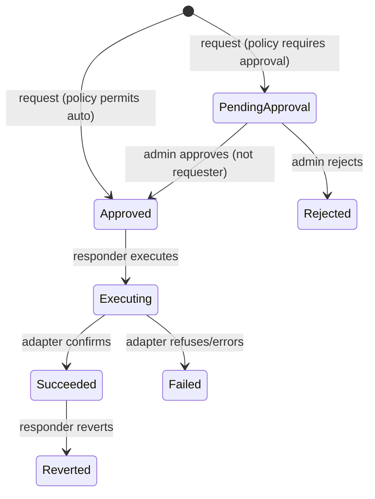
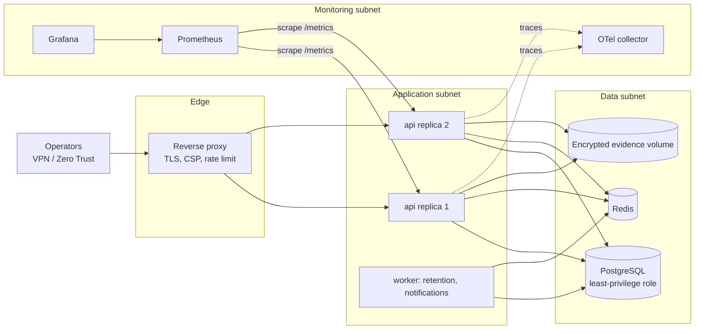

# FIRESTORM architecture

FIRESTORM is a defensive security operations platform for networks and devices an
operator is **explicitly authorised** to monitor and protect. It ingests
telemetry, evaluates deterministic detections, explains risk, and supports
policy-controlled containment with human approval and full auditability.

Nothing in this document claims comprehensive protection. Coverage is bounded by
the sensors that are actually deployed, the rules that are actually written, and
the integrations that are actually configured.

---

## 1. Design principles

| Principle | How it is implemented |
| --- | --- |
| Layered, independent controls | Five coordinated layers; each adapter reports its own health and can fail without disabling the others. |
| Explainable decisions | Every risk score ships with the contributing signals, weights and sources (`app/services/risk_engine.py`). |
| Evidence over assumption | Detections record rule id, version, confidence, severity and source. Facts and hypotheses are stored separately on incidents. |
| Fail closed | Unassessed devices are restricted, not trusted. Missing admission rules default to restricted access. Unconfigured enforcement adapters refuse to act. |
| Human authority | Approval gates, four-eyes checks, allowlists, emergency release, reversible actions. |
| Honest status | Simulated adapters are labelled `simulated`. Email is not "delivered" until the SMTP server accepts it. Stale telemetry is flagged in the UI. |
| Least privilege | Four roles, separate permissions for viewing, triaging, requesting, approving and executing. |

---

## 2. Component view



---

## 3. Defense layers

| Layer | Purpose | Implementation | Failure mode |
| --- | --- | --- | --- |
| **1. Network visibility** | Flows, DNS, connection metadata, sensor logs | Zeek/Suricata ingestion, normalisation, dedupe by fingerprint | Detection blind spots; dashboard shows `not_configured` for the sensor |
| **2. Device discovery & identity** | Inventory, enrolment, multi-signal identity | Asset registry, segments, posture reports, IP/MAC drift tracking | Unassessed devices are restricted, never auto-trusted |
| **3. Pre-access assessment** | Admission decisions before resource access | Weighted posture score (0–100) + ordered admission rules | No matching rule → restricted access (fail closed) |
| **4. Malware & malicious code** | Signature/pattern detection on authorised files | ClamAV (clamd TCP), YARA rule inventory, threat-intel hash lookup | Unscanned artifacts stay unscored; never executed on the server |
| **5. Intrusion detection & response** | Detect and (where supported) block | Suricata signatures + behaviour rules; passive by default | Inline blocking requires explicit live mode configuration |

Cross-cutting: **correlation** (event windows per source), **risk scoring**,
**incident management**, **evidence**, **notification**, **containment**.

---

## 4. Data flow: one event end to end



Timing budget per event on the reference deployment: single-digit milliseconds
for validation, ~1–5 ms for rule evaluation over a 30-minute window (bounded to
400 related events), and one write per new alert.

---

## 5. Trust boundaries



Assumptions and non-goals:

* The API, database and evidence store are inside a management VLAN reachable
  only from the operations subnet.
* The ingestion key is a shared secret per sensor group; it authorises event
  submission only, never read access.
* FIRESTORM does not scan third-party systems, does not counter-attack, and
  does not attempt to identify real-world attackers.

Full detail: [`security-model.md`](security-model.md).

---

## 6. Data model (summary)

| Table | Purpose | Key fields |
| --- | --- | --- |
| `users` | Operator accounts | role, mfa, lockout counters, password hash |
| `refresh_tokens` | Rotation + revocation | token hash, jti, revoked_at, replaced_by |
| `login_attempts` | Auth anomaly forensics | email, success, ip, user agent |
| `segments` / `assets` | Inventory | cidr, vlan, ip, mac, criticality, trust_state, posture |
| `events` | Normalised telemetry | ts, source, event_type, src/dst, risk_score, fingerprint (unique) |
| `alerts` | Deduplicated detections | rule_id, severity, confidence, risk_score, signals, occurrence_count |
| `suppressions` | Time-boxed suppression | fingerprint, rule_id, expires_at |
| `incidents` | Case management | reference, status machine, facts, hypotheses, affected assets |
| `incident_timeline` | Append-only narrative | kind, actor, message, payload |
| `evidence` | Custody | sha256, size, custody chain, sealed |
| `response_actions` | Containment lifecycle | action_type, status, approvals, mode, result |
| `enforcement_records` | Applied state | kind, target, integration, state, reverted_at |
| `policies` / `admission_rules` | Configuration as data | versioned JSON, priority-ordered rules |
| `audit_log` | Tamper-evident trail | action, actor, detail, previous_hash, entry_hash |
| `notifications` | Delivery status | channel, status, attempts, next_attempt_at |
| `threat_indicators` | Local TI cache | type, confidence, expiry |

Indexes cover time-range queries (`ts`), correlation lookups
(`src_ip`/`dst_ip` + `ts`), alert filtering (`status`, `severity`, `risk_score`)
and dedupe (`fingerprint`).

Migration: `backend/migrations/versions/*_initial_schema.py` (Alembic).

---

## 7. Detection and scoring

Rules are pure functions over an `EventContext` (event + correlated window +
asset facts + threat-intel match). They are testable without sensors.

| Rule | Code | Signal |
| --- | --- | --- |
| R-0001 | malware_detection | Endpoint signature hit |
| R-0002 | endpoint_protection_disabled | Security control tampering |
| R-0003 | port_scan | Port/host fan-out |
| R-0004 | authentication_bruteforce | Failure bursts and spray width |
| R-0005 | dns_tunneling | High-entropy label volume |
| R-0006 | data_exfiltration | Large egress volume |
| R-0007 | lateral_movement | Internal admin-protocol fan-out |
| R-0008 | c2_beaconing | Low-jitter periodic connections |
| R-0009 | cleartext_bulk_transfer | Policy violation |
| R-0010 | threat_intel_match | Feed indicator contact |
| R-0011 | ids_signature | Suricata signature |
| R-0012 | phishing_email | SPF/DKIM/DMARC + links |
| R-0013 | unknown_device_access | Unregistered device on admin port |

Score = severity×confidence base + weighted signals + criticality + repetition +
historical context, clamped to 0–100. Bands (0–19 informational … 80–100
critical) are **policy defaults** in `risk.thresholds`, tuneable and versioned.

Severity and confidence remain distinct fields; the UI shows both.

---

## 8. Response architecture



Guarantees:

* every transition is written to `response_actions` and `audit_log`;
* applied state lands in `enforcement_records` so `emergency-release` can undo
  everything;
* a live adapter that is unconfigured returns `ok=False` and the action is
  marked `failed` — no simulated success is ever reported as real;
* allowlisted hosts/services are rejected before execution.

---

## 9. Frontend structure

```
frontend/src
├── components/     UI primitives, charts, topology
├── hooks/          data fetching, debounce, toasts
├── layouts/        AppShell (collapsible nav, status bar)
├── pages/          Overview, Topology, Events, Alerts, Incidents,
│                   IncidentDetail, Devices, Layers, Policies, Reports,
│                   Audit, Users, Account, Login
├── services/       API client (token rotation), auth context
├── topology/       Deterministic SVG segment/device map
└── types/          Typed API contracts
```

Accessibility and responsiveness: keyboard-focus rings, ARIA labelling on
interactive charts, `prefers-reduced-motion` support, collapsible navigation for
tablet widths, horizontally scrollable data tables, modals with Escape handling
and focus capture.

Design language: graphite/navy surfaces, cyan accents, amber warnings, red for
confirmed criticals, green for healthy, thin luminous borders, restrained
glassmorphism, no decorative fake telemetry.

---

## 10. Deployment topology



Staged rollout (documented in `installation.md`): local dev → isolated lab with
synthetic traffic → passive monitoring of an authorised network → enforcement in
a pilot segment behind approval → gradual expansion.

---

## 11. Phased plan and current status

| Phase | Scope | Status |
| --- | --- | --- |
| 1 | Threat model, architecture, schema, UI prototype | Done |
| 2 | Auth, roles, audit, inventory, device registry | Done |
| 3 | Ingestion, detection, live dashboard | Done |
| 4 | Rules, risk scoring, correlation, notifications | Done |
| 5 | Posture integration, admission policy | Done (simulated enforcement; live adapters require credentials) |
| 6 | Incidents, containment, approvals, recovery | Done (simulated adapters) |
| 7 | Hardening, monitoring, load/restore tests, deployment | Done, with the gaps listed in `feature-status.md` |

See [`feature-status.md`](feature-status.md) for the authoritative
implemented / partial / simulated / pending-external matrix.
